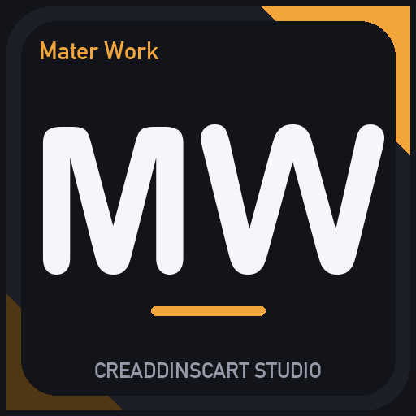

<div align="center">

# MinecraftBotClient — MBC-2.0

**A pure-protocol Minecraft bot client with a collaborative multi-operator terminal.**
Several people join **one** running console and command a huge bot swarm together, live.

`CREADDINSCART STUDIO` · Mater Work · Loder Hankex · jake · jenmnmer · yig

**Made with [CREADDINSCART STUDIO](https://www.shit.pub/studio/)**

[](https://www.python.org/downloads/)


</div>

---

MBC (Minecraft Bot Client) is a pure-protocol bot client written in Python — no game
assets required. It connects to servers, sends chat, runs commands, and (since **2.0**)
lets a whole team share one control console over the network and jointly drive hundreds
of bots.

MBC-2.0 is built on the **MBC 1.0 protocol core** and re-released under the MIT licence
with the four CREADDINSCART STUDIO conditions of use (see [`LICENSE`](LICENSE)).

## What's new in 2.0 — Collaborative Multi-Operator Terminal

The headline feature. Turn the single-user swarm console into a **shared control room**:

- One operator launches MBC-2.0 in swarm mode and opens the **collab console** (a TCP hub).
- Any number of teammates join from **their own terminal** (same machine or across the LAN/WAN)
  with the bundled client — `python -m src.ui.collab_client`.
- Everyone sees the **same live event feed** (bot joins/leaves, broadcasts, presence) and can
  act on the **same swarm** through a shared, lock-protected command bus.
- **Live scaling**: add or kick bots while running, target individual bots, no restart.
- Optional **token auth** so only your team can join.

```
        Operator A ─┐
        Operator B ─┼──TCP──►  MBC-2.0 collab hub  ──►  Bot swarm (10 … 500)
        Operator C ─┘                  │
        Host console ◄────────────────┘  (mirrors every event)
```

### Run it

**Host** — set these in your `config.json` and start MBC:

```json
{
  "multi_bot_enabled": true,
  "bot_count": 20,
  "collab_enabled": true,
  "collab_bind": "0.0.0.0",
  "collab_port": 25599,
  "collab_token": "a-shared-secret"
}
```

```bash
pip install -r requirements.txt
python main.py
```

The host prints the join command and the port. The host console can mirror everything
with `.collab …` (see below).

**Join** — every other operator runs, from another terminal:

```bash
python -m src.ui.collab_client --host <HOST_IP> --port 25599 --name Alice --token a-shared-secret
```

Then type commands (no `.` prefix needed in the shared console):

| Command | Effect |
|---|---|
| `status` | bots alive / total |
| `list` | enumerate every bot (index, name, online) |
| `who` | operators currently connected |
| `say <text>` | broadcast to all alive bots |
| `msg <index\|name\|all> <text>` | message one bot, a name prefix, or all |
| `add <n>` | launch `n` more bots **live** |
| `kick <index\|name\|all>` | disconnect matched bots |
| `nick <name>` | change your operator name |
| `help` / `quit` | help / leave the console |

Host-console equivalents (with the `.` prefix): `.status`, `.list`, `.say <text>`,
`.add <n>`, `.kick <selector>`, and `.collab <status|users|list|say|add|kick>`.

## 1.0 features carried over

- **All versions supported** — auto-detects the server protocol (1.8 → 26.2).
- **SRV records** — resolves `_minecraft._tcp.<domain>` automatically.
- **Bilingual UI** — Chinese / English (picked from the `-zh` / `-en` exe suffix).
- **Vanilla-style autocomplete** — grey inline preview, `Tab` to complete, `↑/↓` or wheel to cycle.
- **Human-like actions** — head turns / arm swings on Bézier trajectories.
- **Multi-bot swarm** — random usernames, staggered joins, auto `/register` / `/login`.
- **Auto-walk, auto-eat, proximity alerts, auto-spam, session logging, fast/offline start.**
- **Cross-platform** — Windows / macOS / Linux.

## Configuration (2.0 additions)

| Key | Default | Description |
|---|---|---|
| `collab_enabled` | `false` | Open the multi-operator shared console in swarm mode |
| `collab_bind` | `"0.0.0.0"` | Interface the hub listens on (`127.0.0.1` = local only) |
| `collab_port` | `25599` | TCP port operators connect to |
| `collab_token` | `""` | Optional join token; empty = open to anyone who can reach the port |

All 1.0 keys (`multi_bot_enabled`, `bot_count`, `bot_auth_*`, `human_actions`, …) are unchanged.

## Project structure

```
MinecraftBotClient-MBC-2.0/
├── main.py
├── build.py
├── requirements.txt
├── LICENSE            # MIT + the four CREADDINSCART STUDIO conditions
├── NOTICE             # upstream 1.0 + code-reuse attribution
├── CHANGELOG.md       # 2.0 release notes
├── assets/avatars/    # independent avatars for all five authors
└── src/
    ├── i18n.py
    ├── logger.py
    ├── client/minecraft_bot_client.py
    ├── network/{connection_manager,version_checker}.py
    ├── settings/settings_manager.py
    ├── ui/{console_ui,collab_client}.py        # collab_client = operator joiner (2.0)
    └── features/
        ├── spam.py
        ├── bot_swarm.py                          # live add/kick/list/targeting (2.0)
        └── operator_hub.py                       # collaborative console hub (2.0)
```

## Authors

| | | | | | |
|:---:|:---:|:---:|:---:|:---:|:---:|
|  |  |  |  |  |  |
| **CREADDINSCART STUDIO** | **Mater Work** | **Loder Hankex** | **jake** | **jenmnmer** | **yig** |

Jointly developed and published. Author field, per the studio conditions:
`CREADDINSCART STUDIO + Mater Work + Loder Hankex + jake + jenmnmer + yig`.

## Build

```bash
python build.py
```

PyInstaller cannot cross-compile — run once per target OS. Artifacts land in
`releases/<version>/<platform>/{zh,en}/`.

## Licence

Released under the **MIT License** together with the **four CREADDINSCART STUDIO
conditions of use** (attribution, made-with line, official link, code-reuse credit) —
full text in [`LICENSE`](LICENSE). MBC-2.0 derives from the MBC 1.0 protocol core; the
upstream attribution is preserved in [`NOTICE`](NOTICE).

> For testing and development purposes only. Use mass-joining only on servers you own
> or are explicitly allowed to test.

Made with [CREADDINSCART STUDIO](https://www.shit.pub/studio/) · [mbc.shit.pub](https://mbc.shit.pub) · [GitHub](https://github.com/creaddinscart/MinecraftBotClient)
